## 项目

| 项目 | 研究方向 | 已实现内容 |
|---|---|---|
| [choravox](https://github.com/FirmwareVersion/choravox) | 多说话人会议语音 | 合成会议工厂（source-filter 语音合成 / image-method RIR / 麦克风阵列 / babble 噪声，全程植入真值）、能量与统计 VAD、UBM/PLDA 说话人嵌入与可选 torch 编码器、说话人日志（AHC / 谱聚类 / VB-HMM，重叠多标签输出）、帧级重叠检测、CTC/SOT 说话人归属 ASR 与目标说话人模式、强制对齐、cpWER/DER/JER 评测与条件切片、在线流式模式（增量聚类与延迟核算）、确定性 SVG/HTML 会议报告与完整 CLI |

520 次提交（2025.01 — 2026.09）· 41 个源码模块 · 4 个可运行离线示例 · 每次提交都经过构建、测试与格式检查。所有测量数字来自带植入真值的确定性合成数据：无真实语料、无预训练权重、全离线可复现。

## 技术栈

## 活动

<picture>
  <source media="(prefers-color-scheme: dark)" srcset="https://raw.githubusercontent.com/FirmwareVersion/FirmwareVersion/output/github-snake-dark.svg" />
  <source media="(prefers-color-scheme: light)" srcset="https://raw.githubusercontent.com/FirmwareVersion/FirmwareVersion/output/github-snake.svg" />
  
</picture>

## 当前关注

- 重叠语音的归属：SOT 序列化输出目标与说话人嵌入重 scoring 的联合解码。
- 在线与离线的差距收敛：增量 leader-follower 聚类的出生/合并阈值，延迟-质量 Pareto 前沿核算。
- 评测方法学：cpWER 匈牙利最优指派、DER 排序 collar 语义，以及合成切片上的诚实校准。
